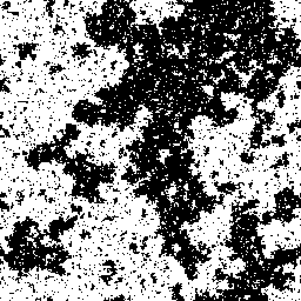
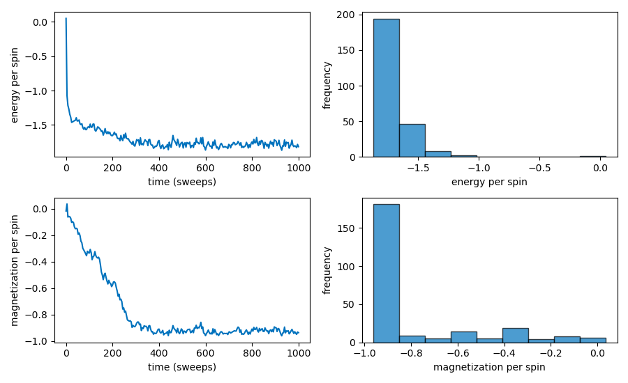
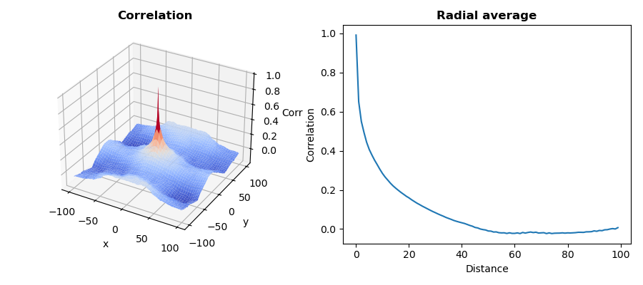
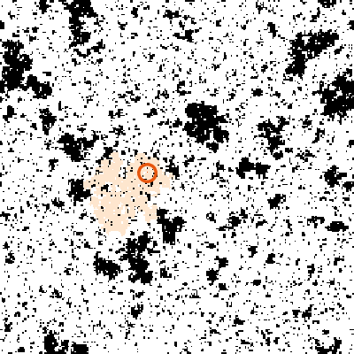
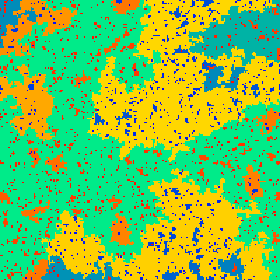

# 2D Ising Model

This repo contains code for simulating the 2D Ising model on a square lattice with Jupyter notebooks and standalone Python scripts (and the original MATLAB version for those crazy enough).

The code demonstrates:

- Heat bath, Metropolis, and Wolff sampling
- Energy and magnetization traces
- Correlation functions and radial averages
- Cluster-size visualisation and statistics



*An equilibrium spin configuration of a 256 x 256 lattice at the critical temperature (black = up, white = down).*

<table>
  <tr>
    <td align="center"><br>Energy and magnetization relaxing to equilibrium from random spins (heat bath, 0.85 <i>T</i><sub>c</sub>)</td>
    <td align="center"><br>Spin-spin correlations at <i>T</i><sub>c</sub>, decaying slowly with distance</td>
  </tr>
  <tr>
    <td align="center"><br>Wolff demo: a cluster (peach) grown from its seed (circled)</td>
    <td align="center"><br>Spin clusters at <i>T</i><sub>c</sub>, colored by size</td>
  </tr>
</table>

## Setup

From the repo root:

macOS/Linux:

```bash
python -m venv .venv
source .venv/bin/activate
python -m pip install -r requirements.txt
```

Windows PowerShell:

```powershell
py -m venv .venv
.\.venv\Scripts\Activate.ps1
python -m pip install -r requirements.txt
```

Windows Command Prompt:

```bat
py -m venv .venv
.\.venv\Scripts\activate.bat
python -m pip install -r requirements.txt
```

If you are using VS Code or Jupyter, select the `.venv` kernel/interpreter after installing the requirements.

On Windows, the main differences are the virtual-environment activation command and sometimes using `py` instead of `python` to create the environment. The notebook and `python -m ...` commands are otherwise the same. If PowerShell blocks activation scripts, either use Command Prompt or allow scripts for the current shell session.

## Jupyter Notebooks

Use these for teaching and interactive exploration:

- `jupyter/IsingSim.ipynb`: main simulation notebook
- `jupyter/WolffDemo.ipynb`: interactive Wolff cluster update demo
- `jupyter/isingsim_funcs.py`: helper functions used by both notebooks (the same functions as in `python/`)
- `jupyter/wolffdemo_funcs.py`: the interactive Wolff demo used by `WolffDemo.ipynb`

The main notebook keeps the important inputs near the top:

```python
N = 100
J = 1
kT_c = 2 / np.log(1 + np.sqrt(2))
kT = 0.85 * kT_c
samplingMethod = 'HeatBath'
```

`N` is the side length of the lattice, so the total number of spins is `N**2`. Values around `50` to `200` are sensible for a lab notebook.

## Standalone Python

Run scripts from the repo root:

```bash
python python/IsingSim.py
python python/WolffDemo.py
python python/ClusterSizeStats.py
```

The raw Python modules are in `python/`:

- `IsingSim.py`: runs a full simulation and plots animation, correlations, energy, and magnetization
- `SampleGrid.py`: implements Heat Bath, Metropolis, and Wolff sampling
- `ClusterSizeStats.py`: plots spin clusters and the cluster-size distribution; run as a script, it animates clusters growing at the critical temperature
- `CorrelationFun.py`, `RadialAverage.py`, `IsingEnergy.py`: analysis helpers
- `WolffDemo.py`, `WolffIteration.py`: Wolff cluster update demo and implementation

Some standalone plots use Matplotlib's Tk backend. If a GUI window does not open, run the notebook version or check that your Python install has Tk support.

## MATLAB

The MATLAB version is in `matlab/`.

Run:

```matlab
IsingSim
```

Useful files:

- `IsingSim.m`: main simulation script
- `SampleGrid.m`: Heat Bath, Metropolis, and Wolff sampling
- `WolffDemo.m`: Wolff cluster update demo
- `ClusterSizeStats.m`: cluster-size visualisation and statistics (needs the Image Processing Toolbox).
  Set `plotClusters = true` in `IsingSim.m` to animate the clusters and their size distribution as the grid evolves.
- `CorrelationFun.m`, `RadialAverage.m`, `IsingEnergy.m`: analysis helpers

## Notes For Lab Use

- Start with `N = 100` for quick feedback.
- Increase `N` only gradually; memory scales as `N**2`.
- `HeatBath` and `Metropolis` update one randomly chosen spin per step, so `N**2` steps make one sweep of the lattice.
  At `N = 100`, the default 100 sweeps take about 5–10 s in Python.
- `Wolff` flips a whole cluster per step and can decorrelate much faster near the critical temperature.
  Starting from a random grid, its clusters are small at first and grow as the grid orders.

## Tests

`tests/test_exact.py` checks the samplers against exact enumeration of a 4x4 periodic lattice, and the correlation functions against a direct calculation.
It runs on both copies of the Python functions (`python/` and `jupyter/isingsim_funcs.py`) and takes about 25 s:

```bash
python tests/test_exact.py
```

`tests/test_exact.m` runs the same checks on the MATLAB functions:

```matlab
run('tests/test_exact.m')
```
